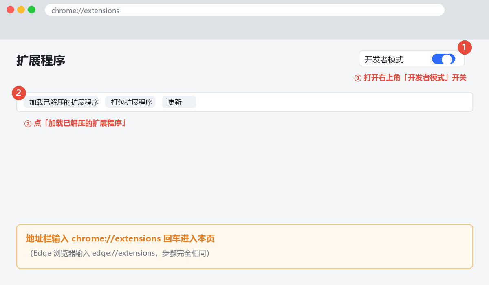
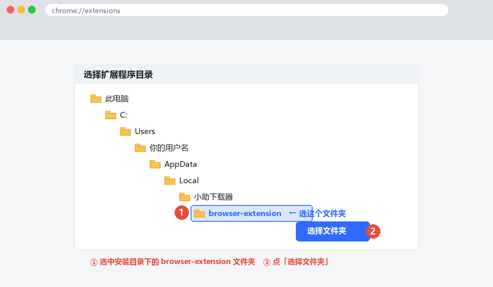
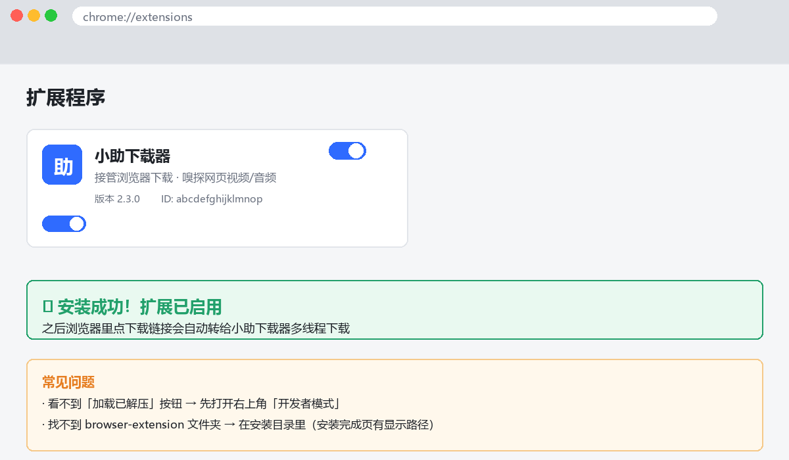
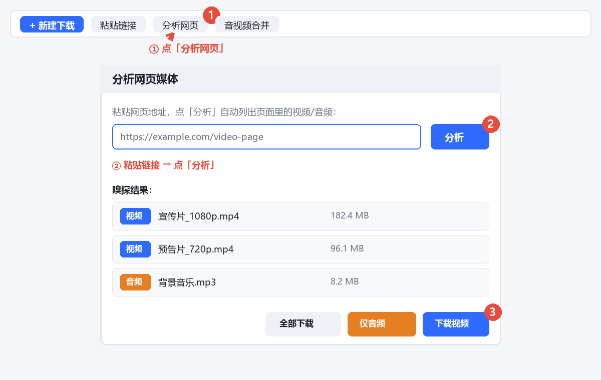
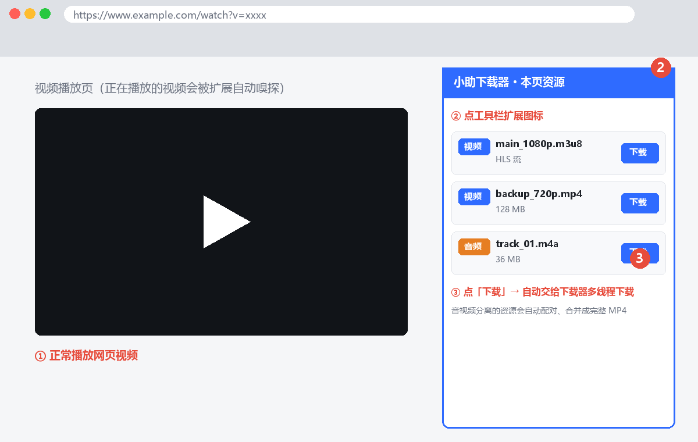

# 小助下载管理器 XZDM（XiaoZhu Download Manager）

> **由 WorkBuddy 开发 · 免费开源 · IDM 平替 · 多线程高速下载 · BT种子 · 磁力链接 · 动态速度均衡**

**一个完全离线、永久免费的开源高速下载管理器** —— IDM 的完美平替，具备三大核心能力：**多线程满速下载 + 网页视频嗅探 + BT种子/磁力链接**（v3.0.0 起），并支持**浏览器接管下载、剪贴板监控、动态速度均衡、任务插队优先**（v3.1.x 起）。
纯本地离线工具：无联网校验、无更新提示、免升级打扰、无注册框、无广告、不收集任何数据。

**关键词**：免费下载器、高速下载器、多线程下载器、BT下载、磁力链接下载、种子下载、BitTorrent、magnet、开源下载器、IDM 平替、IDM 替代、IDM alternative、free download manager、multi-thread downloader、aria2、网页视频嗅探、视频下载、m3u8 下载、B站视频下载、离线工具、WorkBuddy

> 与 IDM 的 10 轮实测对比：**耗时 10/10 胜、稳态速度 10/10 胜、文件完整性（大小 + MD5）10/10 一致**。

---

## 核心特性

| 能力 | 说明 |
|---|---|
| **多线程满速下载** | 区块位图 + 随机写入，最多 **32 线程**；运行中还能随时加线程提速（下载不中断、不重下） |
| **BT种子 / 磁力链接** ⭐ v3.0.0 | 内置 aria2c BT 引擎，支持 `.torrent` 种子文件 + `magnet:` 磁力链；**Trackers 自动更新**（启动时拉取 best.txt），DHT/PEX/LSD 全开启；v3.1.2 起 metadata 预转失败或 120 秒无进展时自动重拉 tracker 并重试一次 |
| **aria2c 引擎可选** ⭐ v3.0.0 | 设置里一键切换默认下载引擎：内置引擎 ⇄ aria2c，aria2c 模式下所有任务（含 HTTP）都走 aria2 通道 |
| **网页媒体嗅探** | 自动嗅探网页视频/音频（`m3u8` / `mp4` / `mp3` / `flv`…），无需网站提供下载链接 |
| **音视频合并** | 自动配对+手动合并双模式，FFmpeg 合成有声有画面的完整 MP4（适用 B站音视频分离） |
| **断点续传** | **1MB 粒度位图**记录，关机 / 崩溃 / 强杀后仍能精确续传 |
| **HLS 下载** | 自动解析 m3u8（含多清晰度选择、AES-128 解密），分片并行后自动合并 |
| **接管浏览器下载** | Chrome / Edge 点链接直接转交本工具，多线程下载 |
| **点链接自动唤起** | 下载器没开时，浏览器一点下载就自动把它静默拉起来 |
| **剪贴板监控** | 复制下载链接自动弹新建窗口；v3.0.8 起改用 Windows 原生剪贴板事件，零 CPU 轮询，取消后再次复制可再触发 |
| **动态速度均衡** ⭐ v3.1.0 | 最多同时跑 3 个任务；线程按获得槽位顺序链式 80% 递减：24 → 19 → 15，其余排队，任务完成后自动递补 |
| **任务插队优先** ⭐ v3.1.1 | 右键插队任务默认满速；槽位满时自动暂停最新唤醒任务，插队任务立即顶上 |
| **开机自启 + 后台静默** | 开机自动进后台，只留托盘图标，不弹窗不打扰 |
| **零骚扰** | 不联网校验、不检查更新、不弹注册框、无广告、不收集数据 |

---

## 性能实测：10 轮对比 IDM

同一台机器、交替先后顺序（单数轮 IDM 先跑，双数轮小助先跑）、串行执行不并发，
第三方标尺为网卡实际吞吐（纯 ctypes 读取 `iphlpapi.GetIfTable`），完整性用 **文件大小 + MD5** 双重交叉核验。

| 组 | 文件大小 | IDM 耗时 | 小助耗时 | 耗时倍数 | IDM 稳速 | 小助稳速 | 稳态倍数 |
|---|---|---|---|---|---|---|---|
| 1 | 178 MB | 10.72s | 10.71s | 1.00x | — | — | 1.20x |
| 2 | 178 MB | 13.06s | 7.16s | **1.82x** | — | — | **2.00x** |
| 3 | 459 MB | 232.50s | 70.22s | **3.31x** | — | — | **3.29x** |
| 4 | 459 MB | 338.63s | 78.73s | **4.30x** | — | — | **3.91x** |
| 5 | 459 MB | 263.50s | 74.41s | **3.54x** | — | — | **3.19x** |
| 6 | 696 MB | 301.38s | 103.87s | **2.90x** | — | — | **2.86x** |
| 7 | 696 MB | 344.98s | 204.58s | **1.69x** | — | — | **1.11x** |
| 8 | 178 MB | 51.69s | 50.22s | **1.03x** | — | — | **1.04x** |
| 9 | 929 MB | 579.44s | 264.01s | **2.19x** | — | — | **2.21x** |
| 10 | 929 MB | 503.43s | 264.01s | **1.91x** | — | — | **1.91x** |
| **平均** | — | **263.93s** | **112.79s** | **2.34x** | 4.35 MB/s | **8.05 MB/s** | **1.85x** |

> 说明：测试环境装有零信任客户端（aTrust）会对公网限速，IDM 在后几组出现掉速至 1.4–3.6 MB/s，
> 这会放大小助的速度优势。第 1、2 组（无限速干扰）更能反映纯粹实现差距。

---

## 快速开始（免安装，双击即用）

### 方式一：安装包（推荐，无需 Python）

下载 **[`xiaozhu-downloader-v3.1.8-setup.exe`](https://github.com/yangg27/xiaozhu-downloader/releases/latest/download/xiaozhu-downloader-v3.1.8-setup.exe)**
（约 41 MB）→ 拷到任意 Windows 11 → **双击安装**。
安装后自动完成开机自启 + `xzd://` 协议注册，无需管理员权限。

### 方式二：源码运行（需要带 tkinter 的 Python 3）

```bat
:: 一次性配置：开机自启 + 协议注册 + 立即后台启动
一键设置.bat
```

| 文件 | 用途 |
|---|---|
| `一键设置.bat` | 一次性配置（自启 + 协议 + 启动） |
| `启动下载器.bat` | 手动后台静默启动（无窗口，只留托盘） |
| `打开下载器窗口.bat` | 打开主界面（已在运行则调出已有窗口） |

---

## 使用要点

### 新建下载
- 工具栏 **「＋ 新建下载」**，粘贴链接
- 或按 **Ctrl+V**：自动从剪贴板提取网址
- 支持填写 Referer / Cookie（视频站点常需要）

### 动态加速（跑满带宽的诀窍）
下载过程中右键任务 → **「⚡ 增加 8/16 个线程」**，立即生效，不重启不重下。

### 下载网页视频
1. **「🌐 分析网页」**：粘贴网页地址，自动列出所有媒体资源
2. **浏览器扩展**：安装后浏览网页即自动嗅探，悬浮按钮一键下载
3. **auto 识别**：直接把 `.m3u8` 丢进来，自动按 HLS 流程处理

### 浏览器扩展安装（Chrome / Edge）
1. 地址栏输入 `chrome://extensions` 或 `edge://extensions`
2. 打开右上角 **「开发者模式」**
3. 点 **「加载已解压的扩展程序」**
4. 选择安装目录下的 **`browser-extension` 文件夹**（整个文件夹，无需解压）

---

## 📖 图文教程

### 教程一：如何安装谷歌浏览器扩展（Chrome / Edge 通用）

**第 1 步**：地址栏输入 `chrome://extensions` 回车（Edge 输入 `edge://extensions`），打开右上角 **「开发者模式」**，然后点 **「加载已解压的扩展程序」**。



**第 2 步**：在弹出的窗口中选中安装目录下的 **`browser-extension`** 文件夹（整个文件夹，无需解压），点 **「选择文件夹」**。



**第 3 步**：看到「小助下载器」卡片说明安装成功 ✅。之后在浏览器点下载链接会自动转给下载器多线程下载。



> 💡 找不到扩展文件夹？它就在安装目录下，名字是 `browser-extension`，点进去能看到 `manifest.json` 即为正确位置。

### 教程二：如何嗅探并下载网页资源

**方式 A：下载器内置「分析网页」**

1. 工具栏点 **「分析网页」**，粘贴网页地址，点 **「分析」**；
2. 自动列出页面里的视频/音频资源；
3. 每条资源可选 **「下载视频」**（有声有画面 MP4）或 **「仅音频」**（MP3）。



**方式 B：浏览器扩展自动嗅探（推荐）**

1. 正常打开视频播放页播放视频；
2. 点浏览器工具栏的 **小助下载器扩展图标**，本页所有视频/音频一览无余；
3. 点 **「下载」** 自动交给下载器多线程下载；音视频分离的资源（如 B站）会**自动配对、合并成完整 MP4**。



---

## 项目结构

```
xiaozhu-downloader/
├── dlcore.py               # 下载引擎（多线程 / HLS / 嗅探），也可当 CLI 用
├── gui.py                  # 图形界面（含托盘、单实例保护）
├── localserver.py          # 本地接口（供浏览器扩展对接）
├── sysintegration.py       # 系统集成（开机自启 / 协议注册 / 单实例转交）
├── tray.py                 # 系统托盘（纯 ctypes，零第三方依赖）
├── _assets/
│   ├── tray.ico            # 托盘与协议图标（打包后位于 _internal/）
│   └── browser-extension/  # 浏览器扩展源码（Chrome / Edge 通用）
├── xzd_app.spec            # PyInstaller 打包配置
├── 使用说明.md              # 使用说明
└── README.md               # 项目说明
```

---

## 技术亮点：那些踩过的坑

本项目在 12 轮版本迭代中修复了若干**只在高并发下才暴露**的隐蔽问题，记录在此供参考：

### 1. `ssl.create_default_context()` 是并发杀手 ★

**现象**：24 线程下载时，启动工作线程莫名耗时 **7.13 秒**（全程空转）。

**根因**：默认路径下每个工作线程都调用了一次 `ssl.create_default_context()`。
单次耗时 **0.491s**（其中 `load_default_certs()` 占 0.257s —— 读 Windows 证书存储、
解码 PEM、构建 X509_STORE），且**全程持有 GIL**。24 个线程排队执行，
本该并行的 TLS 握手硬生生退化成串行。

**隔离实测**（24 线程）：

| 操作 | 串行 ×24 | 并行 ×24 | 结论 |
|---|---|---|---|
| DNS 解析 | 0.097s | 0.153s | 正常并行 |
| TCP 建连 | 1.945s | 0.211s | 正常并行 |
| TLS 握手（每线程各自 create） | 14.439s | **12.691s** | ❌ 完全串行 |
| TLS 握手（共享 context） | — | **0.403s** | ✅ 真并行 |

**修复**：模块级共享一个 `SSLContext`（懒加载 + 探测阶段预热），
`urllib` 的 `HTTPSHandler` 也挂同一个（否则降级路径会重新加载证书链）。

**效果**：启动 24 线程 **7.13s → 0.02s（356×）**，178MB 档总耗时 **15.67s → 11.74s**。

**通用教训**：`ssl.create_default_context()` 是重操作，绝不能放在线程里反复调用。
这类 bug 在单线程测试里完全看不出来。

### 2. 静默数据损坏 bug
异步写盘 + 位图落地的时序缺陷，会导致**下载"成功"但文件损坏**且不报错。
修复后所有对比轮次的 MD5 均与 IDM 一致。

### 3. 启动速度 4.29s → 0.005s（850×）
冻结运行环境的导入链优化。

### 4. 空闲占用优化
长期驻留时 CPU 占用降至 **0.00%**。

> 各版本修复记录见根目录的 `RELEASE_NOTES_v*.md` 与 `TEST_REPORT_v*.md`（含实测数据）。

---

## 隐私与安全

- **完全离线**：不联网校验、不检查更新、不上报任何数据
- **本地存储**：配置与任务记录存放于 `%APPDATA%\小助下载器`（源码运行时为项目内 `data/`）
- **注册表仅写 `HKCU`**：不需要管理员权限，卸载时自动清理
- **零第三方依赖**：托盘、单实例、协议注册均为纯 ctypes / 标准库实现

---

## 环境要求

- Windows 10 / 11（x64）
- 安装包方式：**无需 Python**
- 源码方式：Python 3.9+（需含 tkinter）

---

## 许可

MIT License —— 见 [LICENSE](LICENSE)